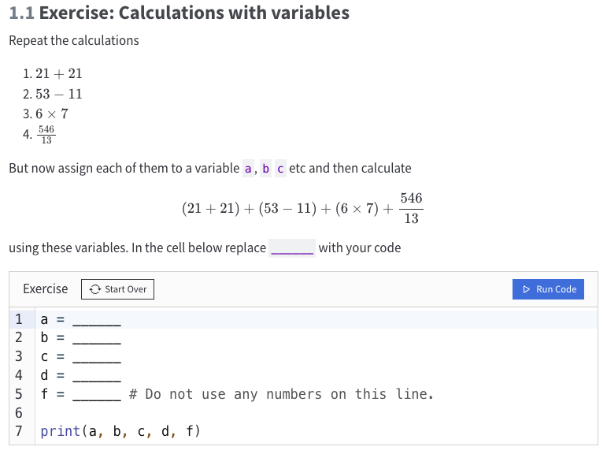
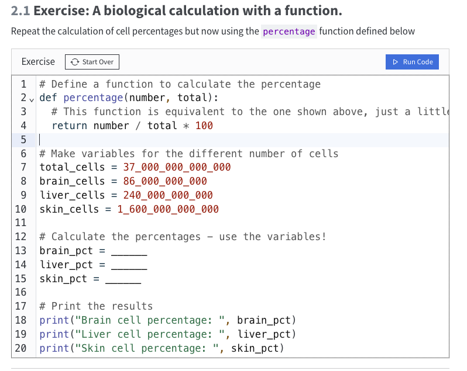
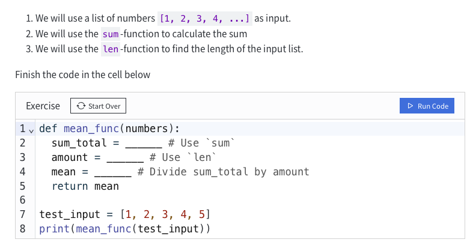
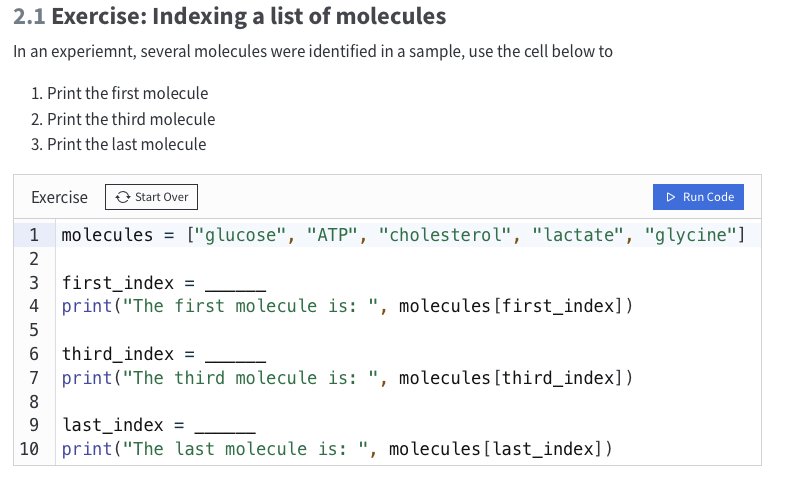
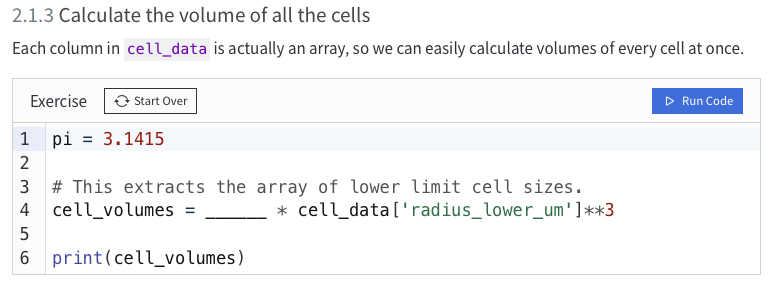
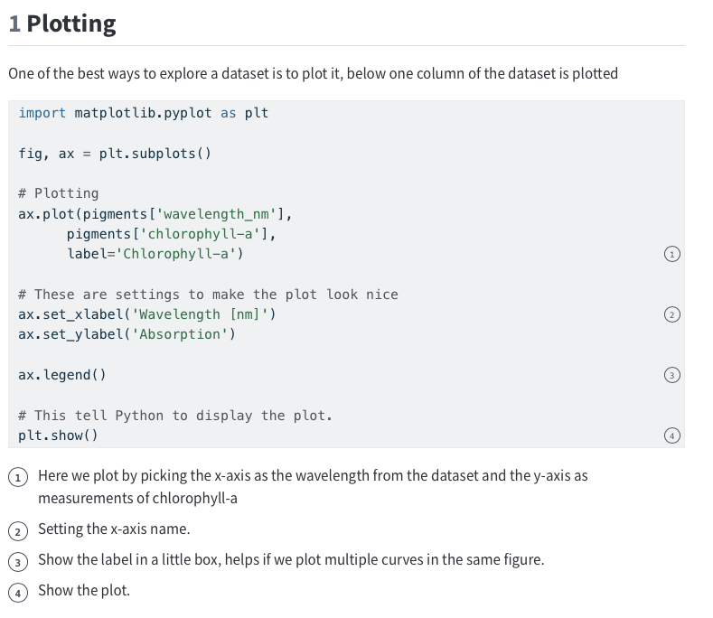
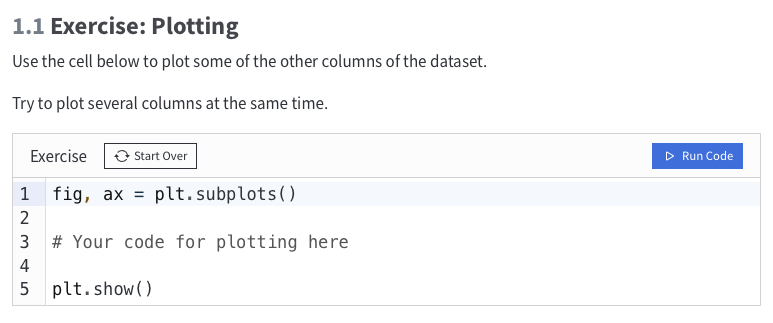
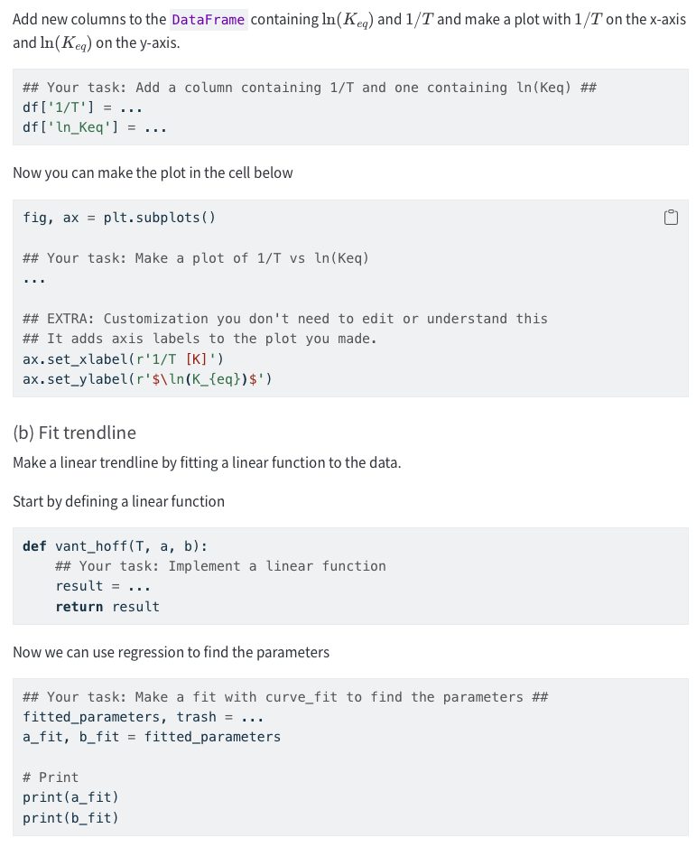
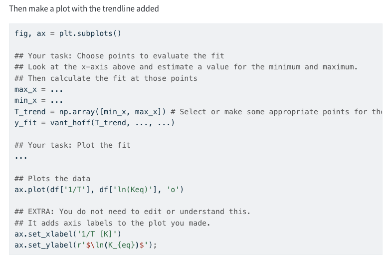

## Livet molekyler
In IMol the student learns to use very simple code pieces and use python as a calculator. The technical setup in this course is a github website that uses an extension called quarto-live which allows the students to write and execute code all on one website.
Example from defining variables and calculations:

Introduction to definitions and how you use them - at this point not expected that they can write a function from scratch but that they can fill it out using scaffold, so it calculates what they need. 

{width=70%}

Use of simple functions such as len() and sum()
{width=70%}

Small introduction to indexing and a small assignment on this
{width=70%}

short introduction to integers, floats and strings
Introduction to arrays and dataframes. 

Introduction to how to do calculations on dataframes and access values in columns. 
{width=70%}

Introduction to plots in python - seeing the code and using this as scaffold to make a single plot as preparation for fysisk biokemi.

{width=70%}
{width=70%}

In Imol they meet all these new expressions but are in no way expected to be able to put code together from scratch. This will still only be taught in Kaspers course Bioinformatics and programming. They are introduced to coding in preparation for fysisk biokemi, for the data analysis part of the course. 

**Summary**

- Light introduction to python
- defining variables and using them for calculations
- Short introduction to integers, floats and string, arrays and dataframes
- Short introduction to a few functions in python and how to use them. 
- First look at how the python package matplotlib can be used for making plots

## Fysisk biokemi
In fysisk biokemi data analysis is no longer performed in excel. Instead the students learn to make plots and basic curve fitting in python. This course uses jupyterlite as the technical solution as this is a browser based page, that does not require the students to install anything. JupyterLite is, as the name implies, a light version og jupyter lab, which means that it works nicely for basic data analysis in basic python packages such as matplotlib and numpy. Should you want to use very big data sets jupyterlite may not be the solution. 

In fysisk biokemi they start out by brushing up on how to do calculations in python by defining variables and using them to do small calculations. Calculatios with dataframes are also revisited and used throughout the course and so is adding a new column to an existing dataframe.  

They also learn to use matplotlib to create plots, by filling out scaffold code. Curvefitting by using the function curve_fit from scipy is also introduced and expected that they can use for the exam. This function rrequires you to define a generel function that returns the function for the type of curve you want to fit. You also have to make an estimate of the parameters to ensure a proper output. 

Examples of an assignment and the level of code the students will be expected to use: 
 

**Summary:**

- Running and using code in JupyterLite
- Making definitions and how to do calculations with them
- Uploading dataframes from csv and excel files.
- Calculations and additions to aready excisting dataframes
- Plotting curves and using curve_fit() to add trendlines to plots

## Genetik 

In the course molecular genetics the students are re-introduced to notebooks. Here they have to run the code in jupyterLite/colab which is also browser based, however this time they will have to become aquinted with markdown and code cells as this is the format they meet in colab and jupyterlite.

In this course no new python skills are introduced, but they will keep working in these and use python codes for visualization. This is done to hopefully show them even more how code can be very helpfull for their future projects and for their learning.

## Strukturbiologi (foreløbig) 

The course strukturbiologi will include two TØ where the students will make plots in python code. The first will include most of the scaffold of code that they have already met in fysisk biokemi. This lesson will be heavy in scaffolding as this course also has students from other bachlors, so in order to make sure everyone knows what is happening, this will be necessary. In the second assignment, the students are expected to use the scaffold code on their own to solve a plotting assignment. 
In this course they will be provided a guide on how to do data analysis in jupyterlite.
They will be given som scaffold but will have to create the notebooks from scratch themselves. This is another small step towards getting the students out of the "sandbox" they have been in so far, and closer to being able to do data analysis on their own in python.

## Bioinformatik og programmering
Kaspers course in bioinformatics and programming will be the first course where the students are expected to code themselves. Here they learn the mindset it takes to solve small problems by code. The expectations is that the students that have now seen and used code multiple times will have an advantage, compared to the student from the old form that had not seen code before this course. 

